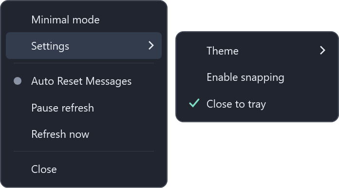
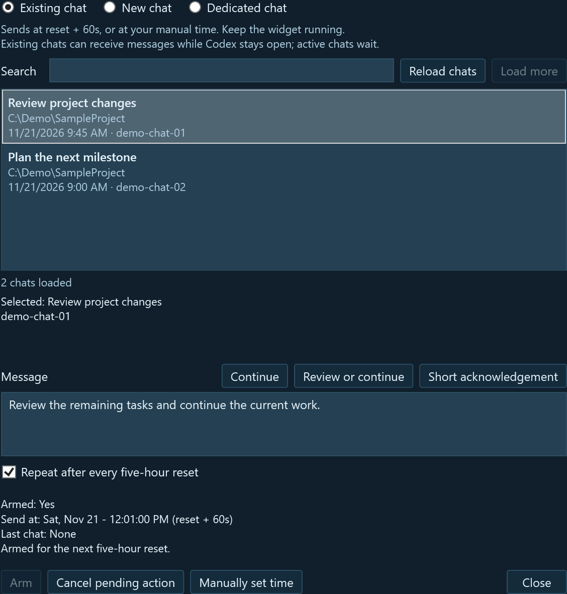

# CodexUsageWidget

An unofficial Windows desktop widget that shows how much of your five-hour and weekly Codex allowance remains and when each window resets. It uses the account signed in to your local Codex installation.


## Features

- **Floating display.** Drag or resize the always-on-top widget. Hover either usage bar for the exact reset time.
- **Minimal mode.** Choose a circle or rounded square in four sizes. Double-click the bubble to switch between percentages and countdowns. Optional background bars show how far each window has progressed toward its reset.
- **Themes and placement.** Choose Midnight, Ocean, or Light. The widget remembers its position across launches and can snap to screen edges or follow another window.
- **Refresh and tray controls.** Refresh intervals adapt to usage changes. Right-click to refresh immediately or pause polling. Closing hides the widget to the system tray by default. Choose **Exit** from the tray to stop it.
- **Optional reset messages.** Use **Auto Reset Messages** to arm a one-time or repeating prompt for an existing, new, or dedicated Codex chat. The widget can send after the five-hour reset or at a manually chosen time. Keep it running for armed messages, which consume normal Codex usage.

## Screenshots

The screenshots use sample usage and chat data.

**Minimal mode** in the Midnight, Ocean, and Light themes, with both shapes shown at the Compact size.


**Widget menu** with refresh controls and the Settings submenu.



**Auto Reset Messages** showing a repeating message armed for an example chat after the five-hour reset.



## Build and run

Requires Windows 10 or 11, .NET Framework 4.8, and the Microsoft Store Codex app or an OpenAI-signed `codex.exe` on an absolute local `PATH` entry. Sign in to Codex with a ChatGPT account that reports both usage windows. The PowerShell build uses the Windows .NET Framework compiler and needs no .NET SDK or NuGet packages.

Build from PowerShell in the repository folder.

```powershell
powershell.exe -NoProfile -ExecutionPolicy Bypass -File .\build-widget.ps1
```

After building, start the widget with `Launch CodexUsageWidget.cmd` or `bin\CodexUsageWidget.exe`. If usage stays offline, check your Codex sign-in and choose **Refresh now** from the widget menu.

## Local data

The widget uses the local Codex app-server interface. Preferences, diagnostics, and any armed message text and chat details are stored under `%LOCALAPPDATA%\CodexUsageBubble` by default. The widget keeps its diagnostics local.

## License

[MIT](LICENSE). CodexUsageWidget is an independent project and has no affiliation with OpenAI.
