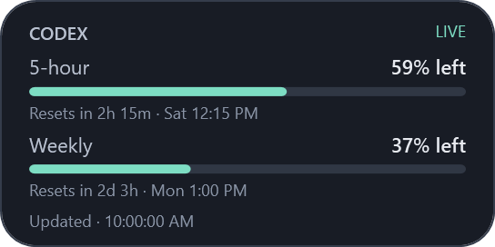
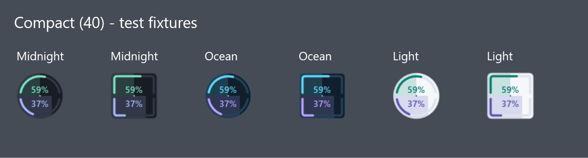
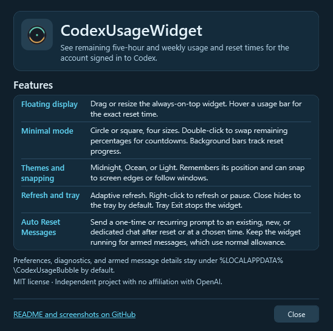

# CodexUsageWidget

An unofficial Windows desktop widget that shows how much of your five-hour and weekly Codex allowance remains and when each window resets. It uses the account signed in to your local Codex installation.



## Features

- **Floating display.** Drag or resize the always-on-top widget. Hover either usage bar for the exact reset time.
- **Minimal mode.** Choose a circle or rounded square in four sizes. The bubble shows remaining percentages by default. Double-click the bubble to switch to countdowns. Reset-time background bars are on by default and show each window’s progress toward reset.
- **Themes and placement.** Ocean is the default theme, with Midnight and Light also available. The widget remembers its position across launches. Snapping is on by default and lets the widget attach to screen edges or follow another window.
- **Refresh and tray controls.** Refresh intervals adapt to usage changes. Right-click the widget to refresh immediately or pause polling. Double-click the tray icon to show or hide the widget. The tray menu includes **Auto-msg**, **About**, and **Exit**. Closing hides the widget to the tray by default.
- **Auto Reset Messages (experimental).** Arm a one-time or repeating prompt for an existing, new, or dedicated Codex chat. The widget can send after the five-hour reset or at a manually chosen time. Keep it running for armed messages, which consume normal Codex usage. Delivery immediately after a live five-hour reset is still unverified.

## Screenshots

The screenshots use sample usage and chat data.

**Minimal mode** in the Midnight, Ocean, and Light themes, with both shapes shown at the Compact size.



**Widget menu** with refresh controls and the Settings submenu.


**Auto Reset Messages** showing a repeating message armed for an example chat after the five-hour reset.


**About** in the Ocean theme, with a feature overview and a link to the README.



## Run the Windows release

Download `CodexUsageWidget-windows.zip` from the [v1.1.0 beta release](https://github.com/cloudd901/CodexUsageWidget/releases/tag/v1.1.0).

1. Verify the ZIP’s SHA-256 against the checksum in the release notes. The executable is unsigned.
2. Before extracting, right-click the ZIP in File Explorer and choose **Properties**. On the **General** tab, if **Unblock** appears, check it and click **Apply**.
3. Extract the ZIP and run `CodexUsageWidget.exe`. If you already extracted the ZIP and Windows blocks the app, use **Properties → Unblock → Apply** on the extracted executable.

## Build and run

Requires Windows 10 or 11, .NET Framework 4.8, and the Microsoft Store Codex app or an OpenAI-signed `codex.exe` on an absolute local `PATH` entry. Sign in to Codex with a ChatGPT account that reports both usage windows. The PowerShell build uses the Windows .NET Framework compiler and needs no .NET SDK or NuGet packages.

Build from PowerShell in the repository folder.

```powershell
powershell.exe -NoProfile -ExecutionPolicy Bypass -File .\build-widget.ps1
```

After building, start the widget with `Launch CodexUsageWidget.cmd` or `bin\CodexUsageWidget.exe`. If usage stays offline, check your Codex sign-in and choose **Refresh now** from the widget menu.

## Local data

The widget uses the local Codex app-server interface. Preferences, diagnostics, and any armed message text and chat details are stored under `%LOCALAPPDATA%\CodexUsageBubble` by default. The widget keeps its diagnostics local.

## License

[MIT](LICENSE). CodexUsageWidget is an independent project and has no affiliation with OpenAI.
